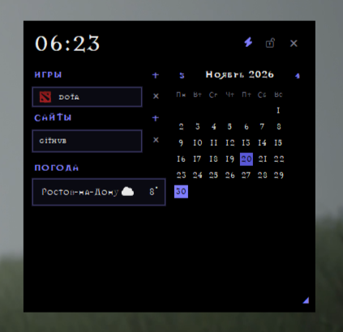
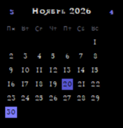
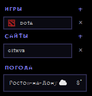

# Widget

Десктопный виджет для Windows на Python/Tkinter: игры, сайты, погода и календарь в одном компактном окне.



## Что умеет

- **Запуск игр** — EXE-файлы и браузерные игры. Иконки извлекаются из EXE автоматически (через WinAPI + Pillow).
- **Быстрые ссылки** — сайты открываются в браузере по умолчанию.
- **Погода** — текущая температура и emoji-условия через Open-Meteo (без API-ключа). Город настраивается.
- **Календарь** — отметки на дни с подписями событий. Клик по дню → ввод события. Кружок = событие есть.
- **Всегда на рабочем столе** — виджет не перекрывает окна, уходит под них через `HWND_BOTTOM`, но остаётся над обоями.
- **Запуск с Windows** — кнопка ⚡ создаёт `.bat` в `shell:startup`.
- **Фиксация позиции** — 🔒/🔓 блокирует перетаскивание.
- **Ресайз** — ручка `◢` в правом нижнем углу (280×280 … 800×800).

## Скриншоты

| Календарь | Список игр |
|---|---|
|  |  |

## Установка

```powershell
git clone https://github.com/awxke/widget.git
cd widget
pip install pillow